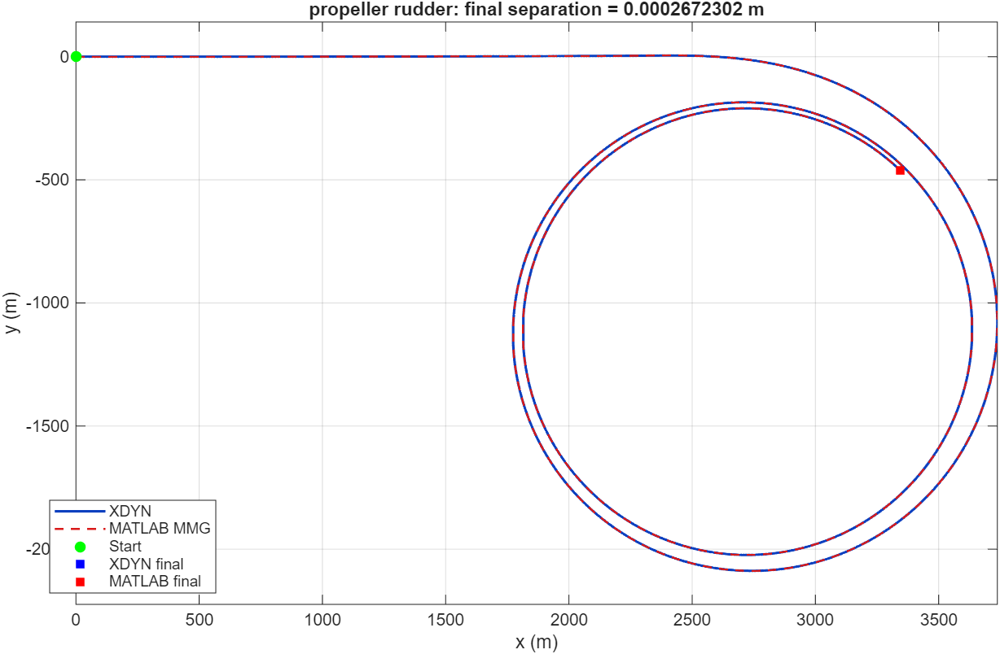
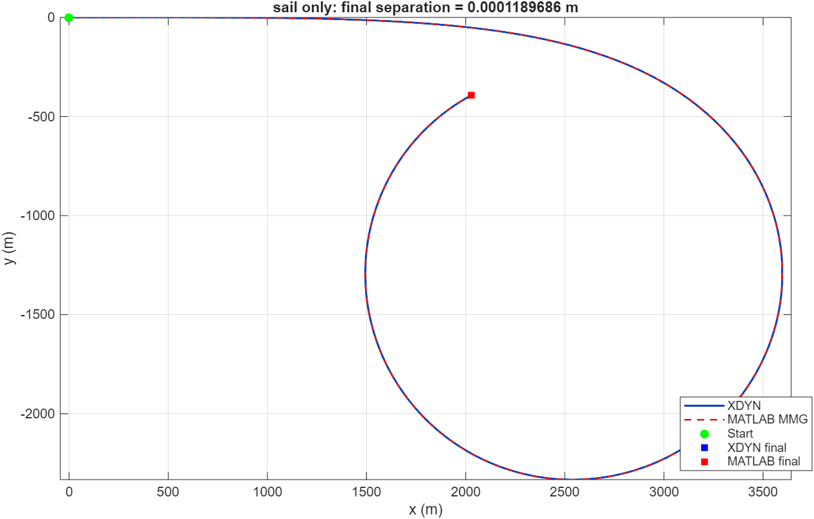
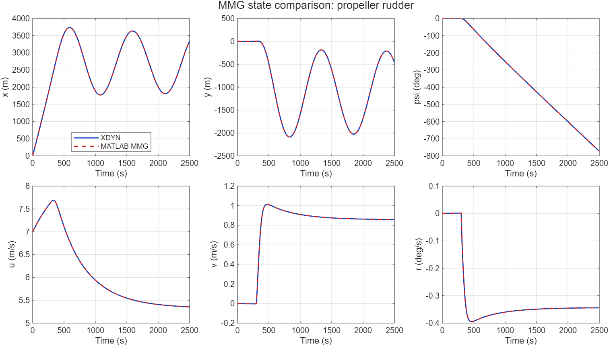
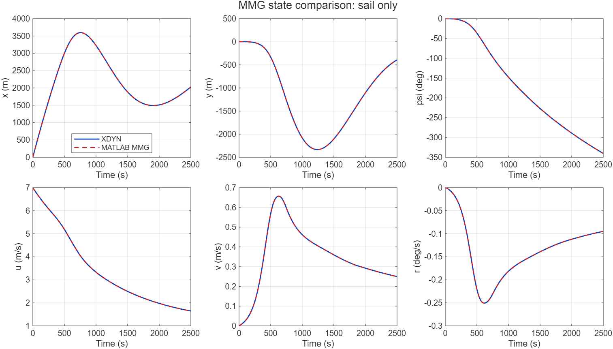
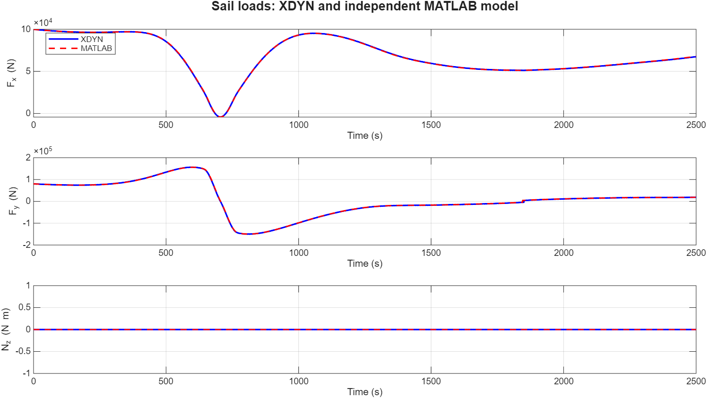
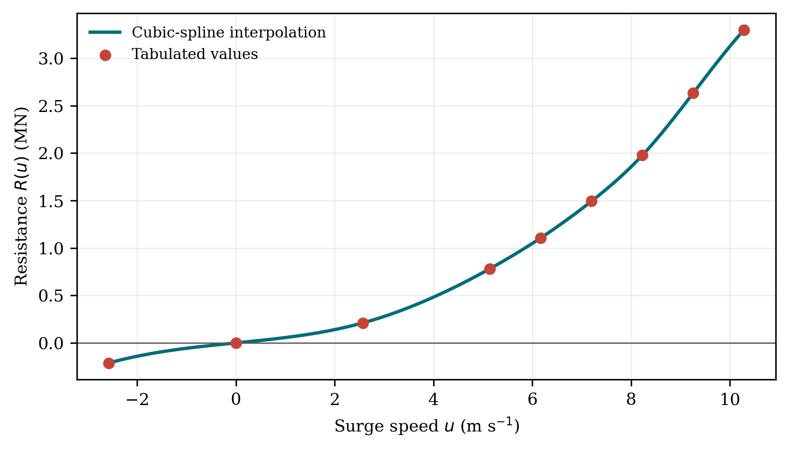
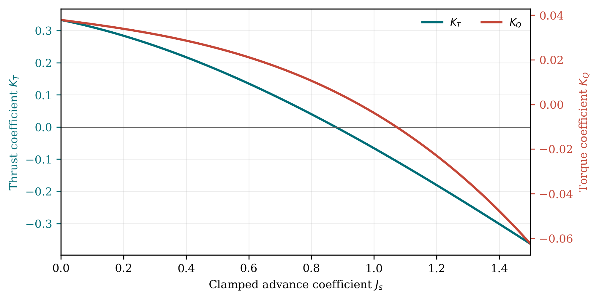
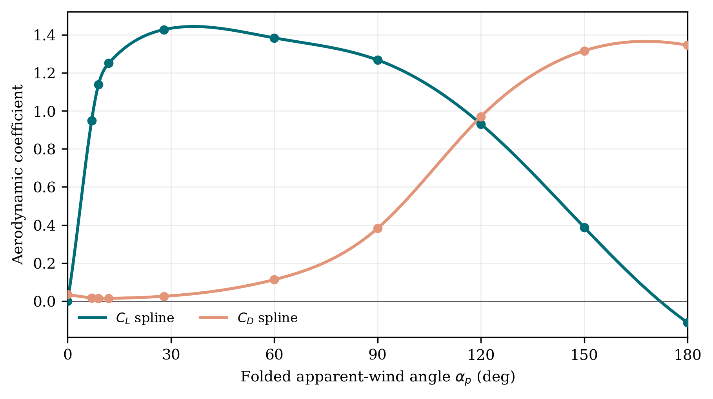

# Sail-Assisted Ship Model — MATLAB/XDYN Handover

**Yonatan Tamiru Asfaw | Nonlinear marine dynamics | MATLAB / XDYN**

[Results gallery](docs/RESULTS.md) | [Model inputs and sources](docs/SOURCES.md) | [Project report](Nonlinear_Modelling_and_Validation_3DOF_Sail_Assisted_Ship%20(1).pdf)

This package contains the **XDYN reference cases** and the **independent MATLAB model used for MATLAB-XDYN comparison**. The model follows surge, sway and yaw, with six integrated states: position, heading and body-frame velocities.

## Results at a glance

Two thesis cases compare independent MATLAB predictions with XDYN under matched inputs over **2,500 s**. These are **model-to-model numerical comparisons**; the figures are archived thesis results.

| Reported metric | Propeller + rudder | Sail only |
|---|---:|---:|
| XDYN path length | **15.335 km** | **8.620 km** |
| Final planar separation | **0.267 mm** | **0.119 mm** |
| Maximum planar separation | 0.704 mm | 0.703 mm |
| Six-state NRMSE | < 1.3 x 10<sup>-5</sup> % | < 1.0 x 10<sup>-5</sup> % |

Source: thesis Chapter 4, Tables 4.1-4.3 and Section 4.2.2. Final separation is the endpoint difference, not the maximum error along the path. The thesis defines NRMSE using each reference state's peak-to-peak range.

<table>
<tr><th>Propeller + rudder</th><th>Sail only</th></tr>
<tr>
<td></td>
<td></td>
</tr>
<tr><td>Turning manoeuvre after rudder application at 300 s. Thesis Fig. 4.2.</td><td>Wind-driven trajectory with matched final positions. Thesis Fig. 4.5.</td></tr>
</table>

<details>
<summary><strong>See the six-state and sail-load comparisons</strong></summary>

### Propeller-rudder response



Position, heading, surge/sway velocity and yaw rate reproduce the XDYN response (thesis Fig. 4.1).

### Sail-only response



The six-state response for the sail-only case (thesis Fig. 4.4).



Longitudinal/lateral sail forces and direct sail yaw moment (thesis Fig. 4.3). The direct yaw moment is zero in this configuration; this does not imply zero vessel yaw, because the full rigid-body inertia treatment retains moment coupling.

</details>

## From modelling inputs to simulation

The force model combines **MMG hull loads**, **tabulated calm-water resistance**, **Wageningen propeller regressions**, a **propeller-slipstream rudder model**, and **apparent-wind sail aerodynamics**.

<table>
<tr><th>Resistance</th><th>Propeller</th><th>Sail</th></tr>
<tr>
<td></td>
<td></td>
<td></td>
</tr>
<tr><td>Thesis Fig. A.1 / Table A.6.</td><td>Thesis Fig. A.2 / Section A.9.</td><td>Thesis Fig. A.3 / Table A.10.</td></tr>
</table>

[Explore all 12 figures with captions](docs/RESULTS.md) - hull geometry, rudder interaction, wind construction, sail forces, response histories and trajectories.

[Read the source and provenance guide](docs/SOURCES.md) - where the numerical inputs came from and which references support each component.

## Folder structure

| Folder | Contents | Start here |
|---|---|---|
| `01_XDYN_Reference_Generation` | Three XDYN YAML cases: propeller + rudder, sail only, and combined | `README.md` / `run_both_yml.m` |
| `02_MATLAB_Model_and_Comparison` | MATLAB model, comparison functions, plots, and the three matching XDYN CSV files | `RUN_MODEL.m` |
| `results/figures` | 12 original modelling and comparison figures | [Gallery](docs/RESULTS.md) |
| `docs` | Figure captions, thesis cross-references and modelling sources | [Sources](docs/SOURCES.md) |

## Available cases

| Case | XDYN YAML | XDYN CSV | MATLAB selection |
|---|---|---|---|
| Propeller + rudder | `mmg_prop_rudder.yml` | `mmg_updated.csv` | `usePropellerRudder=true`, `useSail=false` |
| Sail only | `sail_only.yml` | `sail_only.csv` | `usePropellerRudder=false`, `useSail=true` |
| Combined | `mmg_combined_sail.yml` | `combined.csv` | `usePropellerRudder=true`, `useSail=true` |

## Recommended procedure

1. **To inspect or regenerate XDYN reference data:** open `01_XDYN_Reference_Generation`.
2. **To run the MATLAB model and compare it with XDYN:** open `02_MATLAB_Model_and_Comparison`, set it as the MATLAB Current Folder, and open `RUN_MODEL.m`.
3. Select the required actuator case in section 1 of `RUN_MODEL.m`.
4. For comparison, set:

```matlab
cfg.compareToXDYN = true;
cfg.referenceCSV  = '';   % automatically selects the matching CSV
```

5. Run the **whole** `RUN_MODEL.m`. The results window overlays MATLAB and XDYN states/trajectory/loads and provides error metrics.

The supplied CSV files correspond to the supplied XDYN YAML cases. If operating inputs are changed, regenerate the matching XDYN CSV before interpreting the comparison.

## Project report

The [accompanying PDF](Nonlinear_Modelling_and_Validation_3DOF_Sail_Assisted_Ship%20(1).pdf) documents the nonlinear modelling and validation work. Numerical validation results must be interpreted using the operating inputs and actuator configuration documented in that report.

## Requirements and attribution

MATLAB is required for the independent model and comparisons. Regenerating the reference data also requires a separately installed XDYN executable and its dependencies. XDYN is an external reference simulator; this repository does not claim authorship of XDYN or redistribute its executable.

Engineering project by Yonatan Tamiru Asfaw. Existing files and attribution are retained. No new software license has been assigned, and the models have not been rerun during repository preparation.

The figure gallery uses the supplied thesis images, with exact duplicate copies omitted. Figure provenance and external model references are recorded in [docs/SOURCES.md](docs/SOURCES.md). The original Desktop files were not modified.
