# Modelling and simulation results

[Project overview](../README.md) | [Sources and provenance](SOURCES.md) | [Full thesis](../Nonlinear_Modelling_and_Validation_3DOF_Sail_Assisted_Ship%20(1).pdf)

The figures below follow the thesis narrative: establish the vessel and force-model inputs, then compare the independent MATLAB implementation with XDYN. Figures are the supplied original PNGs, renamed for navigation without altering their contents. Thesis page numbers below are the **printed** page numbers.

## 1. Vessel and force-model inputs

### Vessel geometry

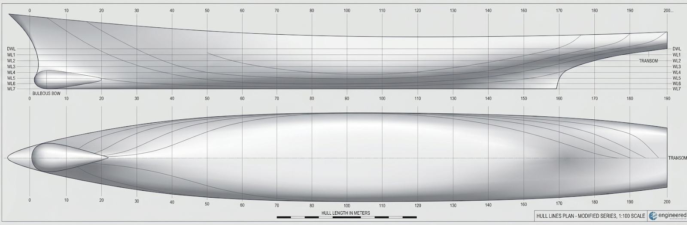

**KVLCC2 hull used for the vessel model.** Thesis Fig. 1.1, p. 3. This is geometry/reference material, rather than a simulation result. The thesis does not identify a separate original image creator.

### Calm-water resistance

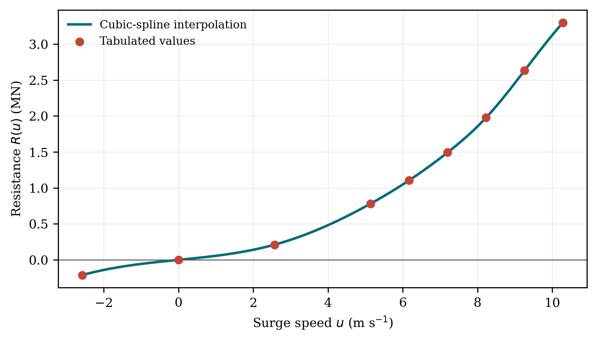

**Tabulated resistance and cubic-spline interpolation.** Thesis Fig. A.1, p. 36; input samples in Table A.6, p. 35. The surge equation uses minus R(u). These samples come from the XDYN configuration; the curve is a model input, rather than an experimentally validated result of this project.

### Propeller characteristics

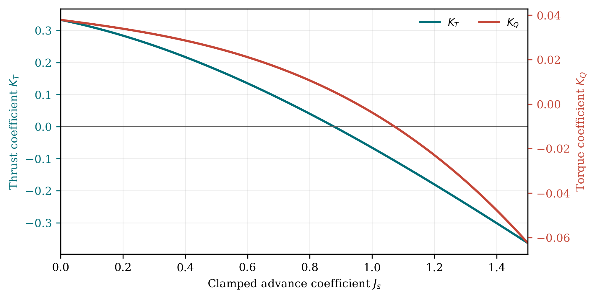

**Wageningen B-series thrust and torque regressions.** Thesis Fig. A.2, p. 37; Appendix A.9. The illustrated configuration uses pitch ratio 0.79, expanded-area ratio 0.431 and five blades. The implementation clamps the advance coefficient to [0, 1.5]. Regression method: Oosterveld and van Oossanen (1975); numerical arrays reproduced from XDYN.

### Propeller-rudder interaction

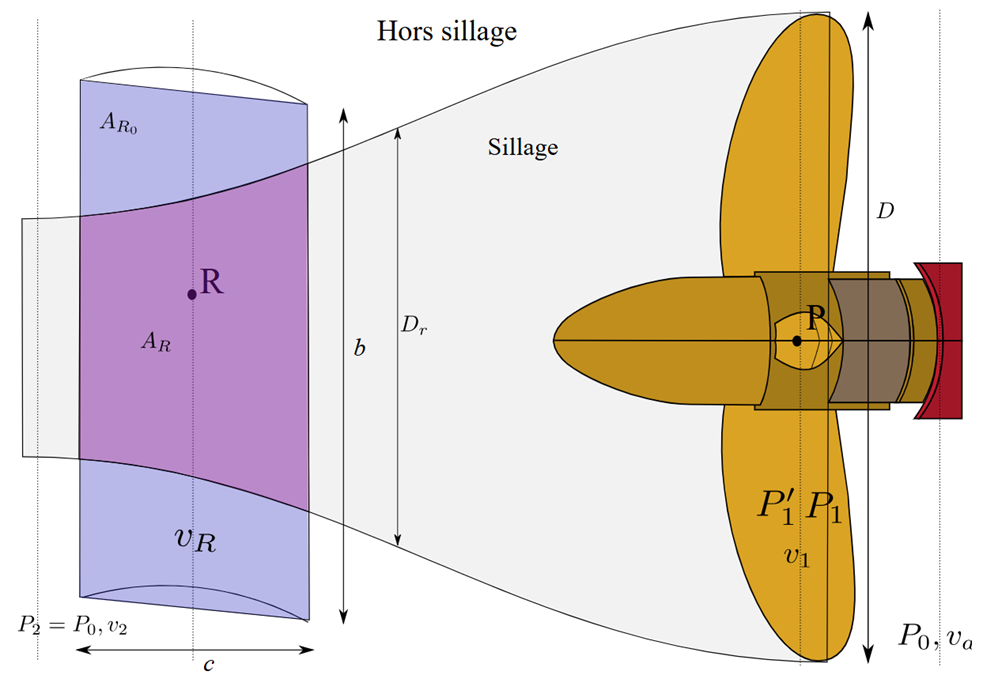

**Slipstream and rudder-area split.** Thesis Fig. 3.1, p. 15, credited there to SIREHNA / XDYN (2020). The rudder model evaluates the portions inside and outside the propeller wake separately. See thesis Section 3.2.1 and Appendix A.6.

### Wind and sail-force construction

<table>
<tr><th>True and apparent wind</th><th>Sail lift and drag</th></tr>
<tr>
<td>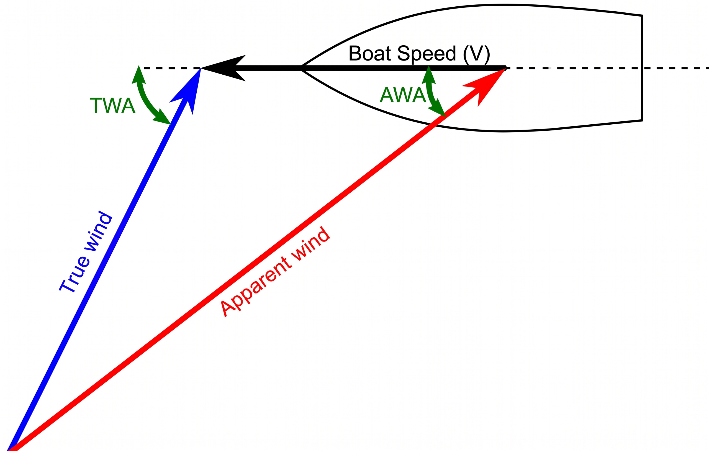</td>
<td>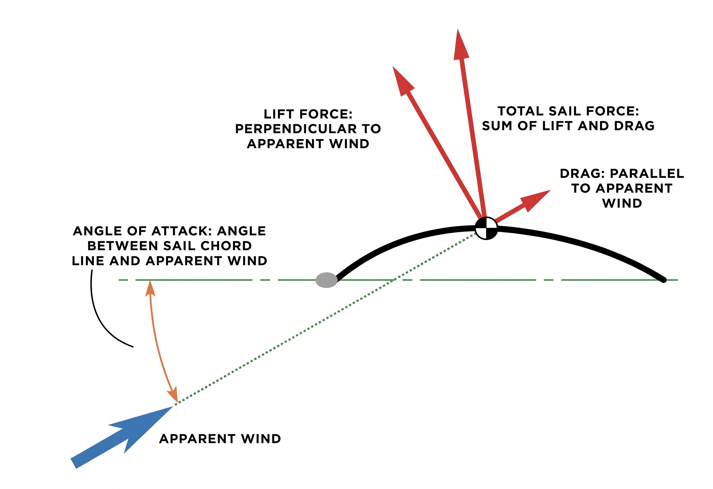</td>
</tr>
</table>

**Wind transformation and aerodynamic force directions.** Thesis Fig. 3.2(a)-(b), p. 17. Apparent wind depends on the environmental wind and the velocity at the sail application point. The surrounding formulation follows Charlou et al. (2023) and XDYN; the thesis does not give separate original image credits for these two illustrations.

### Sail aerodynamic polar

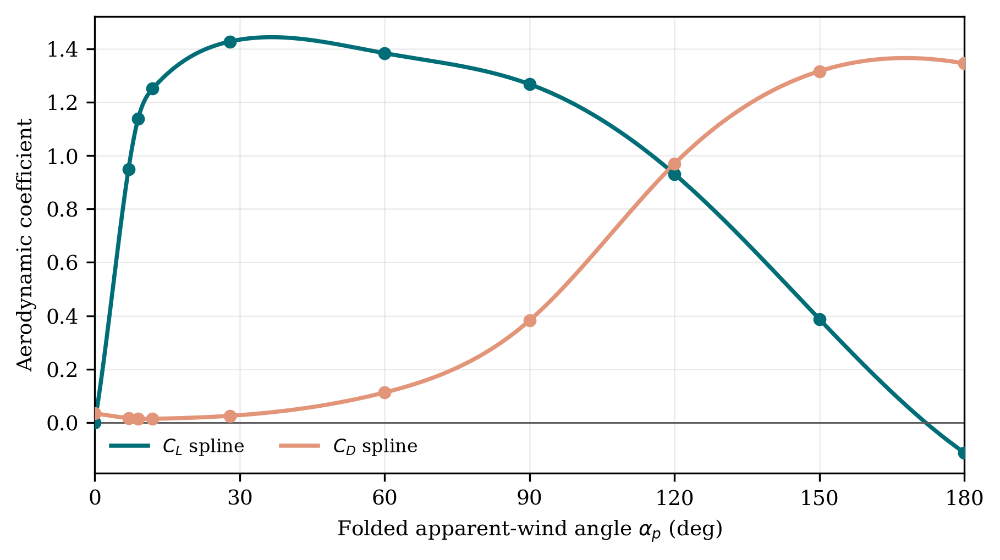

**Lift/drag coefficients and cubic-spline interpolation.** Thesis Fig. A.3, p. 42; Table A.10, p. 41. The tabulated polar is an XDYN/WISAMO configuration input. The sail-only test uses 1,000 m2 reference area, 10 m/s true wind and a 90-degree wind-travel bearing (Table A.9).

## 2. Propeller-rudder numerical comparison

The MATLAB and XDYN implementations share vessel parameters, initial conditions, actuator inputs and a 2,500 s simulation interval. The rudder is applied at 300 s.

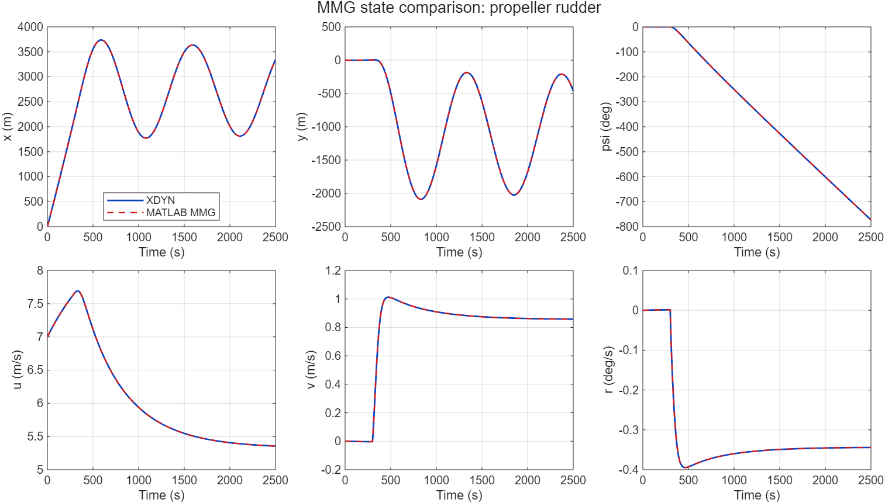

**Six-state response comparison.** Thesis Fig. 4.1, p. 21: earth-frame x/y position and heading, body-frame surge/sway velocity and yaw rate. The response histories remain closely overlaid before and after rudder application.

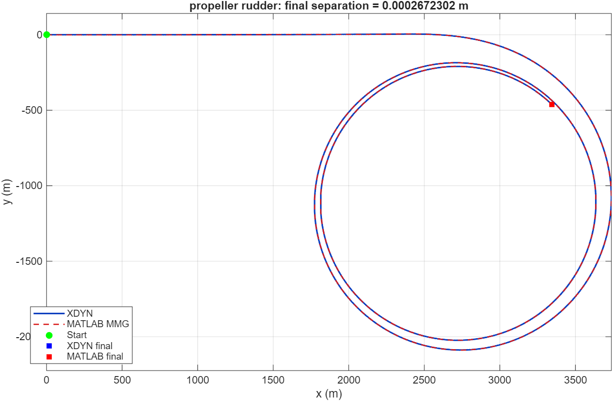

**Horizontal-plane trajectory.** Thesis Fig. 4.2, p. 23. The final endpoint separation is **0.2672302 mm** over an XDYN path of **15,335.12 m**; maximum planar separation over the complete run is **0.7038098 mm** (Table 4.2). All six state NRMSE values are below **1.3 x 10-5 %** (Table 4.1).

## 3. Sail-only numerical comparison

This case isolates hull, resistance and sail loads over 2,500 s.

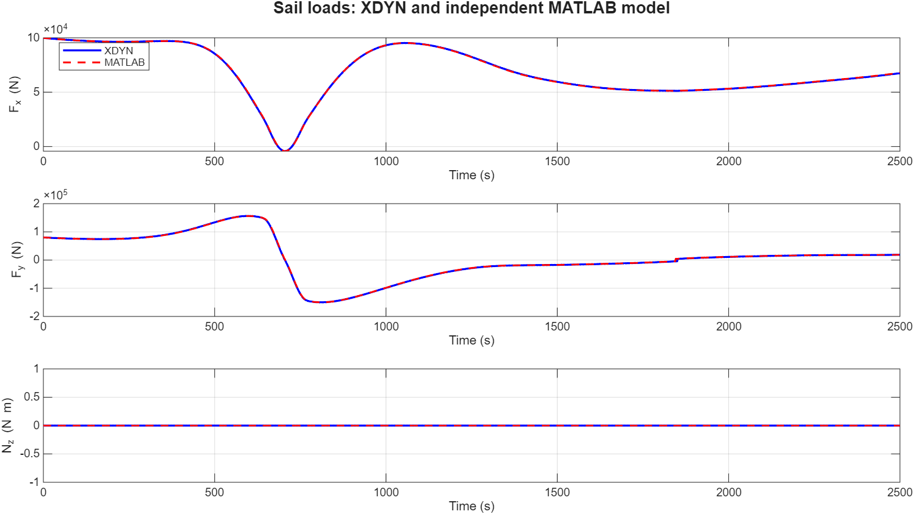

**Sail-load agreement.** Thesis Fig. 4.3, p. 24. MATLAB reproduces the longitudinal force, lateral force and direct sail yaw moment, including the force changes around 600-800 s. Direct sail yaw moment stays zero for this centre-line configuration. Roll/pitch moments and off-diagonal inertia coupling can still influence yaw acceleration; zero direct yaw moment does not mean no vessel rotation.

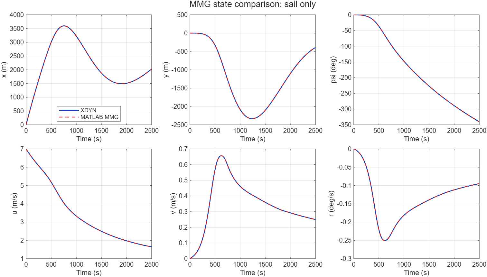

**Six-state response comparison.** Thesis Fig. 4.4, p. 25. The two implementations reproduce the changing vessel speed, lateral motion and heading over the full run.

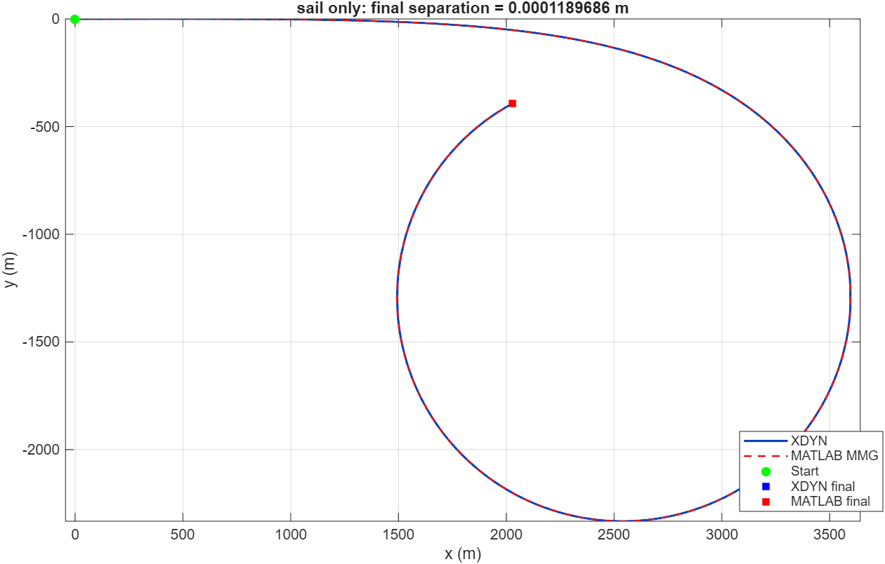

**Horizontal-plane trajectory.** Thesis Fig. 4.5, p. 26. Final separation is **0.1189686 mm** over an **8,619.756 m** XDYN path; maximum separation is **0.7030385 mm**. All six state NRMSE values are below **1.0 x 10-5 %** (Section 4.2.2 and Table 4.3).

## Reading the results

- These are **numerical model-to-model verification results**, not measured sea-trial accuracy or evidence of fuel savings.
- Final planar separation measures the two endpoints. Maximum separation measures the largest difference anywhere along the trajectories; the two metrics must not be interchanged.
- NRMSE is a percentage normalised by the corresponding XDYN state's peak-to-peak range (Appendix B). It is not the same quantity as a position error in millimetres.
- The repository includes a combined actuator case, but this gallery reports only the two cases documented by the supplied thesis figures and metrics.
- The archived figures and thesis metrics were documented here without rerunning the simulations.
